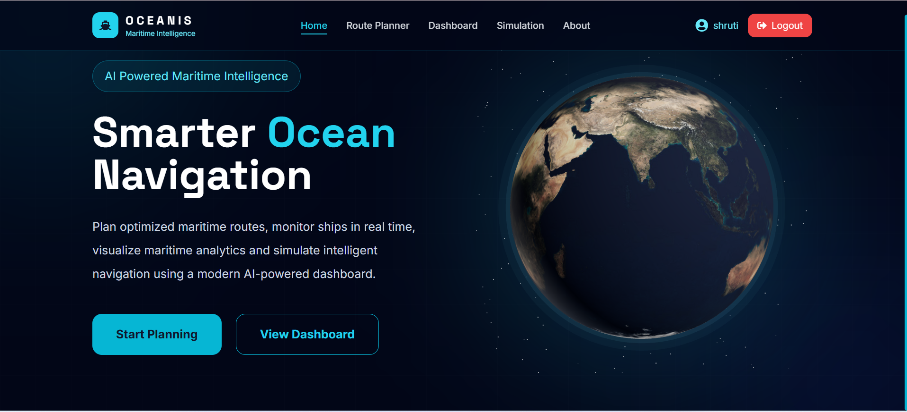
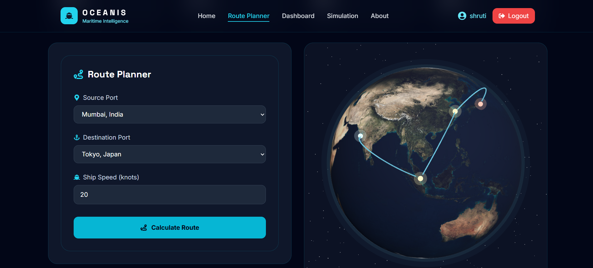
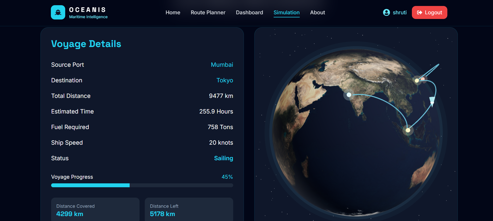

# 🌊 OCEANIS — Maritime Shipping Network Visualization System

OCEANIS is a maritime shipping route visualization project designed to explore shipping routes, shortest-path planning, and ship movement across a global network of ports.

The application combines an interactive 3D globe with route planning, voyage information, and shipping-related predictions to demonstrate how graph algorithms can support maritime logistics.

## ✨ Features

- 🌍 **3D Globe Visualization** — Explore the maritime world through an interactive Earth view.
- ⚓ **Port Network** — Work with a network of global shipping ports.
- 🧭 **Shortest-Path Route Planning** — Calculate a route between selected ports using graph-based routing.
- 🚢 **Ship Route Simulation** — Visualize ship movement along the planned route.
- 🌦️ **Weather Information** — View weather-related information through the application's weather integration.
- ⛽ **Fuel Prediction** — Estimate fuel requirements for a planned voyage.
- 📊 **Dashboard** — View shipping and voyage-related information.

## 🛠️ Tech Stack

**Frontend**
- React
- Vite
- Tailwind CSS
- Three.js and React Three Fiber
- React Router

**Backend**
- Java
- Spring Boot
- REST APIs

**Database**
- MySQL

## 🏗️ Project Structure

```text
OCEANIS/
├── client/       # React frontend
└── server/       # Spring Boot backend
```

## 🚀 Getting Started

### Prerequisites

Install the following before running the project:

- Node.js and npm
- Java 17 or compatible project JDK
- MySQL
- Git

### 1. Clone the repository

```bash
git clone https://github.com/sshrrutiiii/OCEANIS.git
cd OCEANIS
```

### 2. Start the backend

Open the `server` directory in your IDE, configure your MySQL connection, and run the Spring Boot application.

The backend runs on:

```text
http://localhost:8080 

Production backend URL:
https://oceanis-1jdp.onrender.com
```

### 3. Configure the frontend

Create or update `client/.env` with the required frontend environment variables:

```env
VITE_OPENWEATHER_API_KEY=your_openweather_api_key
```

Replace the placeholder with your own API key. **Do not commit your `.env` file or publish your API key.**

### 4. Start the frontend

Open a terminal in the `client` directory and run:

```bash
npm install
npm run dev
```

Open the local URL printed by Vite, usually:

```text
http://localhost:5173
```
## 📸 Project Screenshots

### 🏠 Home Page


### 🧭 Route Planner


### 🚢 Ship Simulation


## 🗺️ How It Works

1. Select a source port and destination port.
2. Request a shipping route through the backend.
3. View the calculated route and voyage information.
4. Explore the ship's movement through the simulation.
5. Review available weather and fuel-related information.

## 🔮 Future Enhancements

- AI-assisted route recommendations
- Weather-aware route optimization
- Fuel-efficient voyage planning
- Estimated time of arrival (ETA) prediction
- Port congestion and maritime risk analysis
- Live vessel tracking and alerts
- AI-powered shipping assistant

## 🎯 Project Goal

OCEANIS aims to combine graph algorithms, full-stack development, and interactive geospatial visualization into a maritime logistics simulation.

## 👩‍💻 Author

**Shruti Dixit**

GitHub: [@sshrrutiiii](https://github.com/sshrrutiiii)

---

*OCEANIS is an evolving project. Some advanced capabilities listed above are planned future enhancements.*
